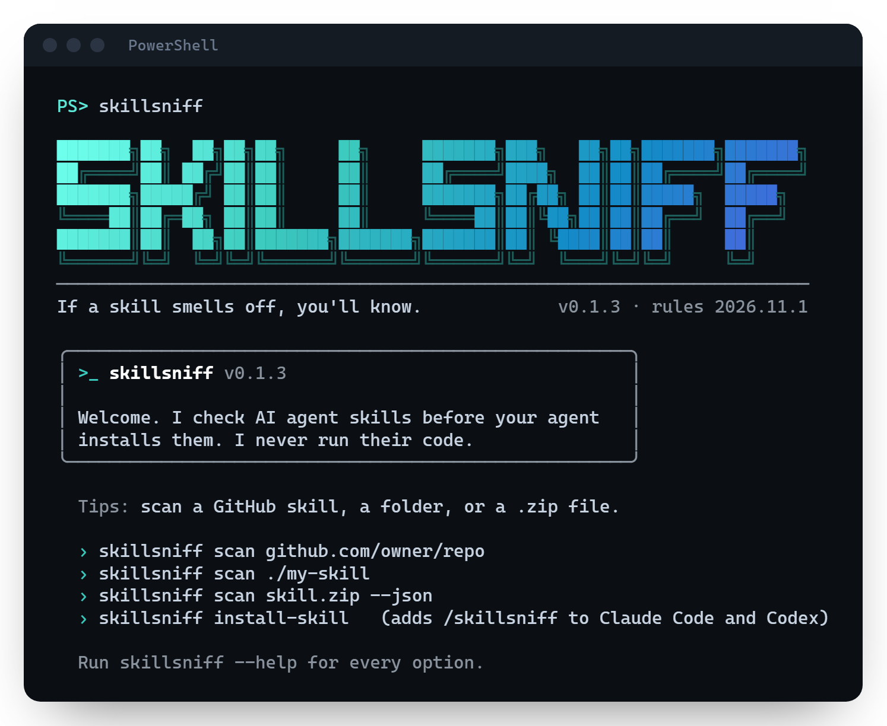
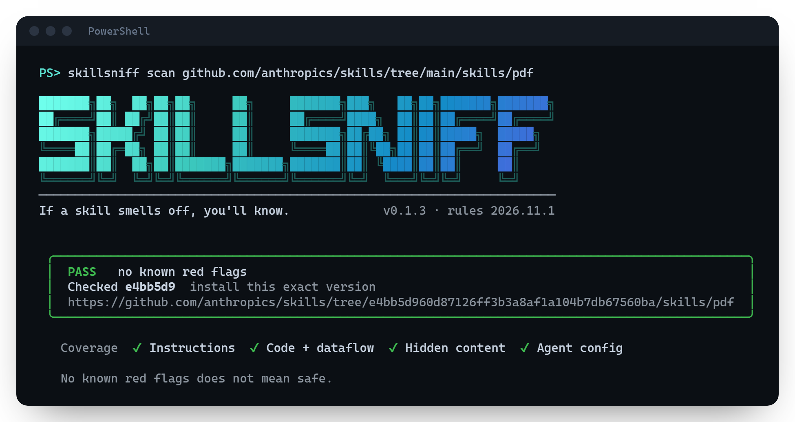
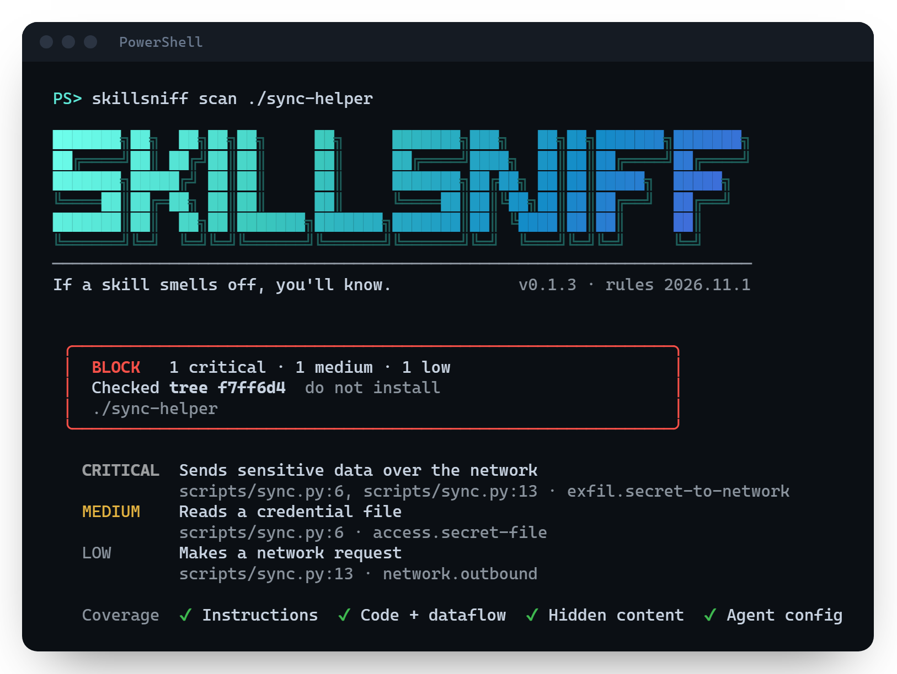

<div align="center">



**If a skill smells off, you'll know.**

[](https://github.com/Haikeysgit/skillsniff/releases/latest)
[](https://github.com/Haikeysgit/skillsniff/actions/workflows/ci.yml)
[](#license)
[](#supported-platforms)
[](https://www.rust-lang.org)

[Install](#install) · [Use it](#use-it) · [How it works](#how-it-works) · [What it catches](#what-it-catches) · [Roadmap](#roadmap) · [Known limits](docs/limits.md) · [Security](SECURITY.md)

</div>

---

Agent skills give your coding agent new abilities on demand. You install one, call it by name, and your agent knows how to do something new.

But a skill is also a bundle of instructions and scripts that your agent trusts and runs on your computer. Most people install skills without reading them, and a bad one can steal your passwords and keys, or quietly make your agent do things you never asked for.

skillsniff checks a skill before you install it. It reads every instruction and every script, never runs any of them, and gives you one clear answer: **PASS**, **CAUTION** or **BLOCK**, with the exact file and line behind every finding.

Install it once, and your agent checks every skill for you from then on.

## Why skillsniff

Skills give your agent abilities like brainstorming, debugging, reviewing and planning. A malicious skill can:

- tell your agent to skip permission prompts
- read your SSH keys, cloud credentials or API tokens and send them to a remote server
- hide instructions in characters you cannot see
- pull in more instructions from the internet after you install it
- quietly change your agent's settings so it keeps running in the background

skillsniff checks a skill before it ever reaches your agent.

## Install

### Ask your agent

Paste this into Claude Code or Codex:

> Install skillsniff (the skill and its program) from https://github.com/Haikeysgit/skillsniff

Your agent copies the skill, installs the small `skillsniff` program it uses, and sets everything up. Start a new session afterwards, and you're done.

### From a terminal

Two steps in any terminal: PowerShell, macOS Terminal, or your editor's terminal.

**1. Install the program.** Pick one:

```sh
# macOS and Linux (Homebrew)
brew install Haikeysgit/skillsniff/skillsniff
```

```powershell
# Windows (PowerShell)
powershell -ExecutionPolicy Bypass -c "irm https://github.com/Haikeysgit/skillsniff/releases/latest/download/skillsniff-cli-installer.ps1 | iex"
```

```sh
# Windows (Scoop)
scoop bucket add skillsniff https://github.com/Haikeysgit/scoop-skillsniff
scoop install skillsniff
```

```sh
# macOS and Linux (without Homebrew)
curl --proto '=https' --tlsv1.2 -LsSf https://github.com/Haikeysgit/skillsniff/releases/latest/download/skillsniff-cli-installer.sh | sh
```

**2. Add it to your agents.** Open a new terminal and run:

```sh
skillsniff setup
```

It finds Claude Code and Codex on your computer and adds the skillsniff skill to each one.

### Other ways

- **Claude Code plugin:** `/plugin marketplace add Haikeysgit/skillsniff`, then `/plugin install skillsniff@skillsniff`.
- **skills CLI** (needs Node.js): `npx skills add Haikeysgit/skillsniff -g`. Your agent installs the program the first time the skill runs.
- **winget:** `winget install Haikeysgit.skillsniff` works once Microsoft approves the package.
- **By hand:** download an archive from the [releases page](https://github.com/Haikeysgit/skillsniff/releases) and put `skillsniff` on your `PATH`.

> [!TIP]
> **For AI agents installing this skill:** the skill is `skills/skillsniff/SKILL.md` in this repository. Copy the `skills/skillsniff/` folder into your skills folder (Claude Code: `~/.claude/skills/skillsniff/`, Codex: `~/.agents/skills/skillsniff/`). Then follow the **Setup** section of that SKILL.md: it installs the `skillsniff` program.

## Use it

### In your agent

Once skillsniff is installed, just ask your agent to install a skill as usual. It checks the skill first, shows you the verdict and only installs the exact copy it checked.

To check a skill without installing it, type `/skillsniff` and give it a link.

| Verdict | What your agent does |
| --- | --- |
| 🟢 **PASS** | Installs it. Every check ran and found no known red flags. |
| 🟡 **CAUTION** | Shows you the findings and asks before installing. |
| 🔴 **BLOCK** | Refuses to install and tells you why. |

### In a terminal

Scan any skill on GitHub, a folder on your computer, or a `.zip` file:

```sh
skillsniff scan github.com/anthropics/skills/tree/main/skills/pdf
skillsniff scan ./my-skill
skillsniff scan skill.zip --json
```

A clean skill:

<p align="center">
  
</p>

A skill that sends your cloud credentials to the internet:

<p align="center">
  
</p>

<sub>The blocked skill is one of skillsniff's own test samples. Its addresses are reserved and it cannot do harm.</sub>

Run `skillsniff --help` for every option. Exit codes: `0` PASS, `1` CAUTION, `2` BLOCK, `3` usage error, `4` fetch failed, `5` internal error.

## How it works

<p align="center">
  
</p>

1. **You ask your agent to install a skill.** Your agent calls skillsniff first.
2. **skillsniff fetches the skill into quarantine** and pins the exact version. Nothing in the skill is ever run.
3. **It analyzes everything:** the instructions, every script, hidden content and configuration changes.
4. **You get one clear verdict** with the file and line behind every finding.

Your agent can raise the alarm on top of skillsniff's findings, but it can never lower a verdict. That rule is enforced in code, so a skill cannot talk its way to a PASS.

## What it catches

| Area | Examples |
| --- | --- |
| **Instructions** | Prompt injection, requests to bypass permissions, hidden instructions, text written to manipulate reviewers |
| **Scripts** | Credentials flowing to the network, download-and-execute, reverse shells, dynamic code execution |
| **Hidden content** | Invisible Unicode, look-alike characters, encoded payloads, unexpected binaries |
| **Agent configuration** | Changes to agent settings, hooks, permission rules, startup items and shell profiles |

Scripts are parsed properly, not pattern-matched, across Python, JavaScript, TypeScript, Bash and PowerShell.

Checks for dependencies (typosquatted packages, known vulnerabilities) and repository history (recent transfers, rewritten history) are planned for Phase 2. See [known limits](docs/limits.md) for what v0.1 does not catch yet.

## Design principles

- **Never runs the skill.** Analysis is static. The skill's code is read, never executed.
- **Can't be talked out of a verdict.** Content inside a skill can never lower its own rating.
- **Install exactly what was checked.** Verdicts are tied to a specific version and content hash.
- **Local first.** No accounts, no telemetry, and it works offline for local skills.
- **One binary.** No Python or Node required. The same results on every operating system.

## Supported platforms

| Platform | Architectures |
| --- | --- |
| macOS | Apple Silicon, Intel |
| Windows | x64 (ARM64 runs the x64 build) |
| Linux | x64, ARM64 |

| Agent | Status |
| --- | --- |
| Claude Code | ✅ Available |
| Codex | ✅ Available |
| Any terminal | ✅ Available |
| Cursor, Gemini CLI, Copilot | Planned |
| MCP server | Planned |
| GitHub Action | Planned |

## Verify a download

Every release archive is listed in `sha256.sum` and carries a signed build provenance attestation:

```sh
sha256sum --check --ignore-missing sha256.sum
gh attestation verify <archive> --repo Haikeysgit/skillsniff
```

## Roadmap

- [x] **Phase 1: Core engine.** Quarantined fetch, instruction and script analysis, hidden content, agent configuration checks, verdicts and reports, agent integrations
- [ ] **Phase 2: Depth.** Cross-file data flow, payload decoding, dependency and repository history checks
- [ ] **Phase 3: Reach.** Plugins and MCP servers, more agents, CI integration, change diffs between versions
- [ ] **Phase 4: Live testing.** Optional sandboxed execution with file and network tracing

See the full [design specification](docs/specs/2026-11-17-skillsniff-design.md) for the threat model and architecture.

## Contributing

Issues, threat model reviews and examples of real malicious skill patterns are very welcome. Read [CONTRIBUTING.md](CONTRIBUTING.md) to get started.

Found a security issue? Please report it privately. See [SECURITY.md](SECURITY.md).

## License

Licensed under either of

- [Apache License, Version 2.0](LICENSE-APACHE)
- [MIT License](LICENSE-MIT)

at your option.
